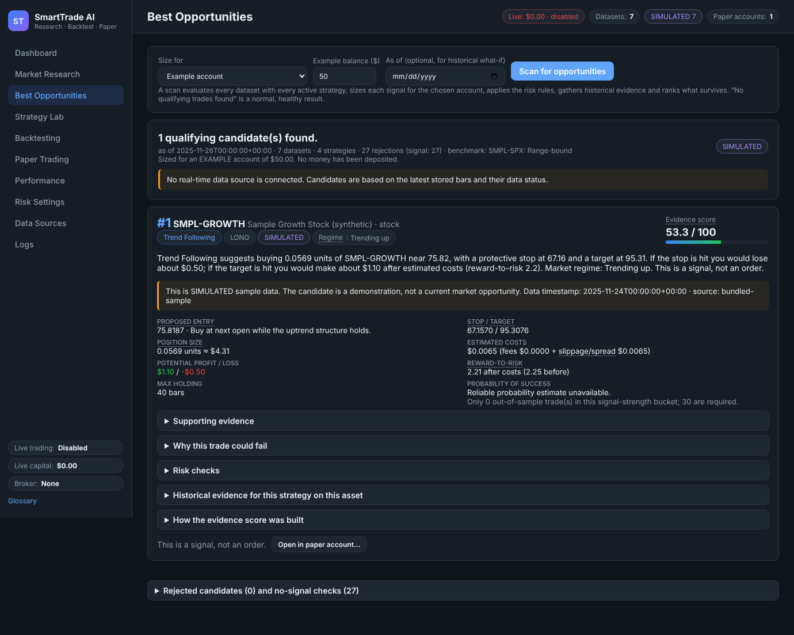

# SmartTrade AI

A local trading **research, strategy-discovery, backtesting and paper-trading** platform
for US stocks, ETFs and major cryptocurrencies.

It runs entirely on your computer. It needs **no money, no brokerage account, no exchange
account, no API keys and no paid subscriptions**. All trading intelligence is local code:
explicit strategy rules, statistical evaluation and historical testing. No ChatGPT, Claude
or any other paid AI model is involved or required.

> **What this is not.** It does not place real orders, it does not connect to a broker, and it
> does not promise a return. The long-term aspiration of turning $50 into $55 in a day is a
> *target*, not a guarantee. The system is designed to say
> **"No qualifying trades found. Waiting for better conditions."** whenever the evidence is not there.

Screenshots of every page are in [`docs/screenshots/`](docs/screenshots/).



---

## 1. Quick start (3 commands)

Requirements: **Python 3.11 or newer** (3.13 tested). Nothing else.

```bash
# 1) Install (one time)
pip install -r requirements.txt

# 2) Start
python -m smarttrade

# 3) Open your browser at
http://127.0.0.1:8000
```

Windows users can double-click `start.bat`; macOS/Linux users can run `./start.sh`.
Both run the same two commands.

Run the automated tests with:

```bash
python -m pytest
```

Starting state on first launch:

| Item | Value |
|---|---|
| Live account equity | **$0** (no broker is connected; never fabricated) |
| Paper-trading balance | $0 until you create a simulated account |
| Paid API budget | $0 |
| Live trading / automated live execution | **Disabled** (cannot be enabled in this version) |
| Broker connections | None |
| Market data | Bundled SIMULATED samples, your CSV imports, optional free downloads |

---

## 2. First session walk-through

1. **Data Sources → "Load bundled sample data".** Seven synthetic daily series (5 stocks/ETF,
   2 crypto) appear, labelled `SIMULATED`. They are generated offline from a documented
   regime-switching model with fixed seeds, so they are reproducible and need no download.
2. **Market Research.** Click *Analyse* on any asset to see the price chart, moving averages,
   RSI, ATR, momentum, relative volume, volatility, support/resistance, data quality, and the
   **market regime** with the rules used to assign it.
3. **Backtesting.** Pick an asset and a strategy, set a simulated balance (e.g. $1,000) and
   press *Run backtest*. Every metric has a tooltip explaining it in plain English. Fewer than
   20 trades is labelled **inconclusive**.
4. **Best Opportunities → "Scan for opportunities".** Every dataset is evaluated with every
   active strategy, each signal is sized for the example $50 account, run through the risk
   manager, backed by historical evidence and ranked. Expand a candidate to see the evidence,
   the reasons it could fail, every risk check and how the score was built.
5. **Paper Trading → Create** an "Example $50 account" (simulated money). Press
   *Advance 20* to replay 20 bars: you will see signals queue, entries fill at the next open,
   stops and targets hit, and the risk rules block entries when limits are reached.
6. **Performance** shows paper results separately from backtests. **Risk Settings** shows
   every limit with its meaning. **Logs** records decisions, rejections and risk events.

### Importing your own historical data (CSV)

On **Data Sources → Import historical CSV** choose a file with columns like
`Date,Open,High,Low,Close,Volume` (Yahoo Finance, Stooq, Binance, broker and spreadsheet
exports are recognised; delimiters, epoch timestamps and time zones are handled). Enter a
symbol and asset class. The importer validates timestamps, duplicates, missing values,
negative or impossible prices, OHLC consistency, gaps and interval consistency, and reports
everything it found. Imported data is labelled `HISTORICAL`.

A ready-made example file is in `smarttrade/data/sample_data/example_import_SMPL-GROWTH.csv`.

### Optional free downloads (no key, needs internet)

* **Stooq** – free end-of-day history for US stocks/ETFs (`SPY`, `AAPL`, ...).
* **CoinGecko** – free daily crypto prices for the last 365 days (`BTC`, `ETH`, ...).

Both are subject to the provider's terms and rate limits. They deliver end-of-day data, so the
freshest label you will ever see is `DELAYED`; the app never labels anything `LIVE` because no
real-time source exists in this version. If a download fails, everything else keeps working.
Set `SMARTTRADE_ENABLE_NETWORK_PROVIDERS=false` in `.env` to run fully offline.

---

## 3. Technology stack

| Layer | Choice | Why |
|---|---|---|
| Language | Python 3.11+ with type hints and dataclasses | Readable quantitative code, no compilation |
| Web/API | FastAPI + Uvicorn | Typed JSON API, one process, serves the UI |
| Database | SQLite via the standard library, versioned migrations | Zero setup, one file in `./data/` |
| Frontend | Plain HTML/CSS/JavaScript (no build step) | `python -m smarttrade` is all you need |
| Charts | Hand-written SVG | No CDN or external dependency, works offline |
| Tests | pytest + httpx | 98 automated tests |

Dependencies: `fastapi`, `uvicorn`, `pydantic`, `python-multipart` (+ `pytest`, `httpx` for tests).
No numpy/pandas required.

---

## 4. Project layout

```
smarttrade/
  __main__.py            python -m smarttrade  → starts the server
  config.py              settings (env vars / optional .env), safe defaults, no secrets needed
  models.py              Bar, Dataset, Signal, DataStatus, Regime ...
  logging_setup.py       structured JSON logging (stdout + rotating file)
  db/                    SQLite connection, repositories, versioned migrations
  data/
    validation.py        OHLCV validator + quality score
    csv_importer.py      flexible CSV parser (layouts, delimiters, epochs, time zones)
    sample_generator.py  deterministic synthetic sample series (SIMULATED)
    providers/           bundled samples, Stooq, CoinGecko (add a provider = one subclass)
  analysis/
    indicators.py        SMA, EMA, RSI, ATR, momentum, returns, volatility, relative volume,
                         breakouts, support/resistance, trend strength, drawdown
    regime.py            explainable regime classifier (rules in the module docstring)
  strategies/
    base.py              look-ahead-safe MarketView, Strategy interface, ParamSpec
    trend_following.py   breakout.py   pullback.py   momentum.py
    registry.py          add a strategy = one class + one registry line
  risk/
    settings.py          configurable limits + plain-English explanations
    costs.py             fee/spread/slippage models per asset class
    position_sizing.py   risk-budget sizing (never rounds up)
    manager.py           the single gate every trade passes (daily loss, floor, R:R, ...)
  backtest/
    engine.py            chronological, leak-free replay with realistic fills
    metrics.py           all performance metrics with explanations
  ranking/
    scanner.py           opportunity scanner (validate → regime → signals → costs → risk → rank)
    evidence.py          in-sample / out-of-sample evidence per asset & strategy
    ranker.py            transparent, weighted evidence score (not a probability)
    calibration.py       probability shown only when calibrated on out-of-sample trades
  research/
    parameter_search.py  grid search with dev/validation/test split + walk-forward
    evaluation.py        performance monitor that pauses/retains strategies by documented rules
  paper/engine.py        paper-trading accounts, positions, clock-driven replay
  api/                   FastAPI routes, services, glossary
  web/                   index.html, styles.css, app.js (the dashboard)
tests/                   automated tests
data/                    created at runtime: smarttrade.db, imports/, smarttrade.log (git-ignored)
```

---

## 5. How the trading intelligence works

**A. Data analysis** – indicators computed in plain Python. Every value at index *i* uses only
bars ≤ *i*, which is what makes the backtester free of look-ahead bias.

**B. Market regime detection** – trending up / trending down / range-bound / high volatility /
low volatility / unclear, from ATR-percent rank, price vs. 50-bar SMA, SMA slope and the
efficiency ratio. The rules are printed in the UI ("How regimes are assigned"). The classifier
reports *unclear* rather than guessing.

**C. Strategy engine** – four independently configurable strategies with explicit entry and
exit rules (shown in Strategy Lab):

| Strategy | Entry idea | Exits |
|---|---|---|
| Trend Following | fast EMA > slow EMA, rising slow EMA, trend strength, not extended | ATR stop, ATR target, EMA cross, time stop |
| Breakout | close above N-bar high on ≥1.3x volume, not extended, room before resistance | stop under the level, target/resistance, failed-breakout close, time stop |
| Pullback | healthy uptrend, 1.5–10% dip to EMA20, RSI 35–60, resumption bar | stop under swing low, prior high + ATR, close < SMA50, time stop |
| Momentum | strong 60-bar return, aligned EMAs, RSI 52–72, not parabolic | ATR stop/target, momentum turns negative, time stop |

**D. Opportunity ranking** – candidates that survive the risk manager are scored on documented,
weighted components: out-of-sample expectancy, consistency, reward-to-risk after costs,
regime fit, cost efficiency, volatility/liquidity and recent deterioration. The weights and
every component value are shown. The score orders candidates; it is **not** a probability.
A probability is displayed only when ≥30 out-of-sample trades in the same signal-strength
bucket exist and beat the base rate (Brier score); otherwise the UI says
*"Reliable probability estimate unavailable."*

**E. Position sizing** – quantity is solved so that the loss at the stop, **including** entry
and exit fees, spread and slippage, equals the risk budget (1% of equity by default), then
capped by cash and concentration limits and rounded **down**.

**F. Risk management** – one `RiskManager.evaluate()` gate for scans, backtests and paper
trading. Checks: equity floor (halts, needs review), cumulative loss limit, daily loss limit,
max positions, duplicate exposure, concentration, benchmark regime, data quality, sizing,
reward-to-risk ≥ 2 after costs, and cost drag (costs may not exceed 50% of the planned loss).
Leverage, shorting and options are locked off. Dollar limits defined for the $50 example
account scale with the balance of each backtest/paper account.

**G. Backtesting** – decisions on each bar's close; entries at the next open plus slippage;
stops checked on lows with gap-through fills at the open; stop assumed before target when both
are touched; strategy exits and time stops filled next open; single position per test;
no partial fills. Assumptions are listed with every result.

**H. Performance evaluation** – net return, return after costs, trade count, win rate, average
win/loss, profit factor, expectancy ($ and R), max drawdown, longest losing streak, fees,
slippage, return on capital, Sharpe, performance by period and by regime; each with an
explanation. < 20 trades → *inconclusive*; negative expectancy is stated as such.

**I. Paper trading** – separate simulated accounts with a clock. Advancing the clock replays
bars across all datasets: pending entries fill at the open, stops/targets are checked, strategy
exits are scheduled, and a new scan runs on the close. All executions and decisions are logged.
Halts at the equity floor require an explicit "I have reviewed – resume".

**Learning from evidence** – the performance monitor evaluates each strategy on its completed
paper trades with fixed criteria (≥20 trades; expectancy ≤ 0, recent profit factor < 0.7 or
drawdown > 12R → paused; mild deterioration → watch). It never changes parameters by itself,
never reacts to one loss and never increases risk. Parameter changes create a new strategy
version with a reason, visible in *Version history*.

**Strategy research** – Strategy Lab tests parameter grids with a chronological
development / validation / final-test split, and walk-forward windows. It tracks the number of
combinations, warns about over-optimisation and about unstable results, and never deploys an
optimised parameter set automatically.

---

## 6. Configuration

Copy `.env.example` to `.env` to change the port, data directory, log level or to disable
network providers. No value is required. No secret is ever needed for basic functionality;
`.env` is git-ignored.

---

## 7. What works without any credentials

Everything described above: loading samples, CSV import, indicators, regimes, scanning,
ranking, backtesting, strategy comparison, parameter research, walk-forward, risk settings,
paper trading, performance reporting and logs. The only things that need internet are the two
optional free providers (which still need no key).

---

## 8. Limitations and unfinished features (honest list)

* **No live or real-time market data.** Free providers give end-of-day bars at best; the UI
  labels data `DELAYED`, `HISTORICAL` or `SIMULATED` accordingly and never pretends otherwise.
  "Current opportunities" are therefore evaluated on the latest stored bar.
* **No live trading, no broker integration, no real orders.** The architecture has a single
  risk gate and a provider interface so an official broker adapter can be added later behind
  explicit user authorisation; nothing in this version can enable it.
* **The bundled sample data is synthetic.** Backtests on it demonstrate the machinery, not
  real market behaviour. Use the CSV importer or the free providers for real history.
* **Stooq and CoinGecko adapters could not be exercised from the build environment** (its
  network policy blocked both hosts). They are implemented against the documented public
  endpoints and fail gracefully; please report any format change.
* **Daily bars only in the providers.** The importer accepts intraday intervals, but the
  strategies were designed and tested on daily data.
* **Execution model simplifications:** no partial fills, no intraday session modelling,
  flat cost estimates per asset class, long-only, one position per backtest.
* **Probability estimates are usually unavailable** by design: they require ≥30 calibrated
  out-of-sample trades per bucket, which small datasets rarely provide.
* **Correlation between positions** is approximated by asset-class concentration limits, not
  by a statistical correlation matrix.
* **Small-account reality:** with a $50 account, 1% risk is $0.50; crypto fees of ~0.4% per
  side often make trades fail the cost-drag or reward-to-risk checks. That is the system
  working as intended, not a bug.

---

## 9. Extending

* **New data provider:** subclass `MarketDataProvider` in `smarttrade/data/providers/`,
  implement `fetch()` and register it in `registry.py`.
* **New strategy:** subclass `Strategy` in `smarttrade/strategies/`, define `param_specs`,
  `prepare()`, `entry_signal()`, `exit_signal()`, and add it to `registry.py`. It automatically
  appears in every page, passes through the same risk manager and gets tested by the
  look-ahead protections.

---

*Historical and paper-trading results are simulations. They are not real money and not a
forecast of future results.*
